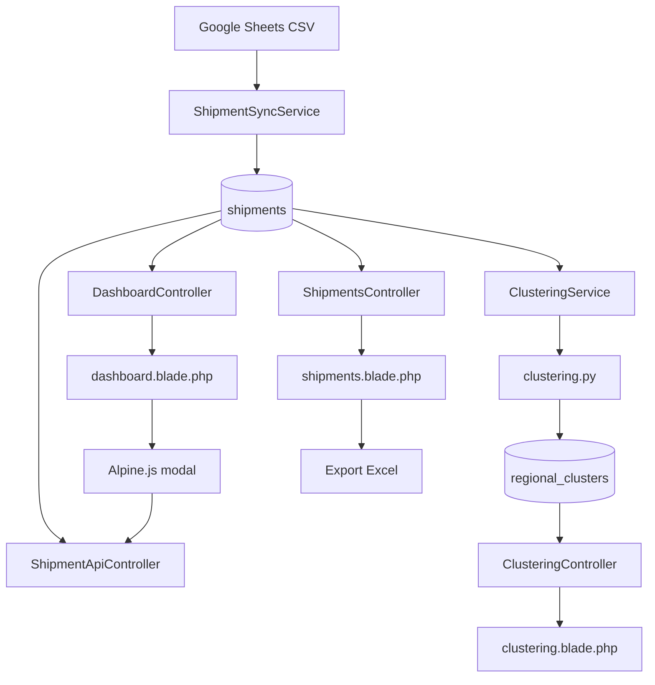
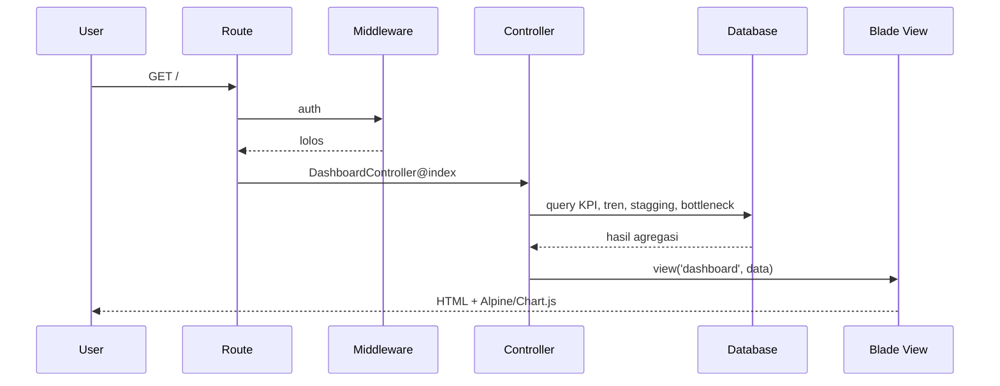

# Ringkasan Arsitektur ANL Dashboard

## Tujuan Sistem

ANL Dashboard adalah aplikasi operasional untuk memantau pengiriman (shipment) dari
sumber Google Sheets vendor BOMA. Aplikasi mengubah CSV publik menjadi data terstruktur,
lalu menyajikan KPI, tren, pipeline stagging, bottleneck SLA, ekspor Excel, dan clustering
kinerja wilayah.

## Teknologi

| Lapisan | Teknologi | Peran |
|---|---|---|
| Backend | PHP 8.3, Laravel 13 | Routing, validasi, autentikasi, query, ekspor |
| Database | MySQL | Penyimpanan `shipments`, `users`, `regional_clusters`, cache, session |
| Frontend | Blade, Tailwind CSS, Alpine.js | Halaman server-rendered dan interaksi modal/filter |
| Grafik | Chart.js | Tren harian, komposisi, scatter clustering |
| Ekspor | PhpSpreadsheet | File `.xlsx` data pengiriman |
| Analitik | Python, pandas, scikit-learn | K-Means clustering wilayah |
| Sumber data | Google Sheets CSV publik | Data pengiriman harian |

## Pola Arsitektur

Aplikasi mengikuti pola MVC Laravel dengan pemisahan tambahan:

```text
Route
  -> Middleware (auth, admin)
    -> Controller
      -> Model / Service
        -> Database / Cache / Google Sheets / Python
    -> Blade View
      -> Alpine.js
        -> API JSON / form POST
```

- **Controller** menangani request, memilih query, dan mengirim data ke view.
- **Model** menyimpan aturan domain yang dekat dengan data, terutama scope SLA,
  range tanggal, dan konsistensi tanggal.
- **Service** menangani proses berat: sinkronisasi CSV dan orkestrasi clustering.
- **View** bertanggung jawab pada presentasi; interaksi ringan memakai Alpine.js.
- **Command** menyediakan operasi CLI dan scheduler.
- **Test** mengunci perilaku penting agar perubahan data tidak merusak dashboard.

## Komponen Utama



## Alur Request Halaman



## Alur Sinkronisasi

1. Scheduler atau tombol **Sync Sekarang** memanggil `ShipmentSyncService::sync()`.
2. Service mengunduh CSV dari `GOOGLE_SHEETS_CSV_URL`.
3. Fingerprint URL dibandingkan dengan cache. Jika URL berubah, mode replace dipaksa.
4. Header CSV dipetakan ke kolom database melalui `columnMap`.
5. Pre-flight menghitung baris yang layak dan menolak sheet kosong atau menyusut drastis.
6. Baris template tanpa data shipment dibuang; baris dengan resi rusak tetapi punya data
   tetap disimpan dengan `no_resi = NULL`.
7. Data di-insert per 500 baris di dalam transaksi.
8. Resi kembar ditandai `is_duplicate_no_resi`.
9. Cache `last_synced_at`, statistik sumber, dan fingerprint diperbarui.
10. Setelah sync sukses, scheduler menjalankan clustering.

Detail: [01-alur-data-dan-sinkronisasi.md](01-alur-data-dan-sinkronisasi.md)

## Alur Clustering

1. `ClusteringService` menulis observasi per pengiriman ke CSV sementara.
2. Python mengagregasi per kota/kabupaten dan menjalankan K-Means `k=3`.
3. Hasil ditulis sebagai JSON.
4. Laravel melakukan upsert ke `regional_clusters`, menghapus wilayah yang tidak lagi ada,
   lalu menyimpan metadata ringkasan ke cache.
5. Halaman `/clustering` membaca tabel dan cache tersebut.

## Autentikasi dan Otorisasi

- Login memakai Laravel Breeze.
- User memiliki `role` (`admin`/`user`) dan `is_active`.
- Akun nonaktif ditolak saat login.
- Middleware `admin` melindungi manajemen user dan tombol sync manual.
- Semua halaman operasional memakai middleware `auth`.

## Prinsip Data yang Dipegang

1. **Jangan mengarang nilai.** Sel kosong disimpan `NULL`, bukan `0`, `"BELUM"`, atau
   `"On Process"`.
2. **SLA dihitung ulang.** Verdict dihitung dari `completed_date` vs `sla_due_date`,
   bukan menyalin teks verdict sheet.
3. **Baris tidak bisa dinilai bukan Out SLA.** Baris tanpa deadline masuk kategori
   tidak terverifikasi.
4. **Resi kembar ditandai, bukan digabung.** Ini menjaga jumlah baris sumber.
5. **Tanggal tidak konsisten dibuang dari agregasi.** Scope `withConsistentDates`
   mencegah tanggal manifest setelah tanggal selesai merusak metrik.
6. **Sync harus aman.** Sheet kosong atau menyusut drastis ditolak sebelum tabel diubah.
7. **Range mengikuti data terakhir.** Filter 30/90 hari memakai `completed_date`
   terakhir yang tepercaya, bukan tanggal hari ini.

## Peta Dokumen

- [01-alur-data-dan-sinkronisasi.md](01-alur-data-dan-sinkronisasi.md)
- [02-skema-database.md](02-skema-database.md)
- [03-peta-route-dan-halaman.md](03-peta-route-dan-halaman.md)
- [04-istilah-dan-rumus.md](04-istilah-dan-rumus.md)
- [05-konfigurasi-environment.md](05-konfigurasi-environment.md)
- [99-pertanyaan-sidang.md](99-pertanyaan-sidang.md)
