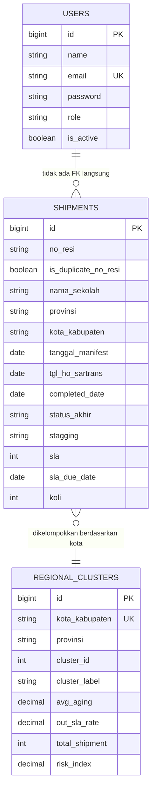
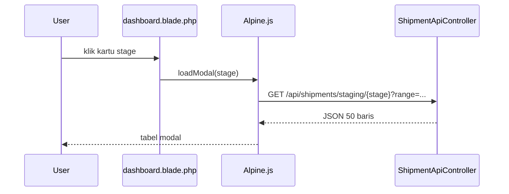
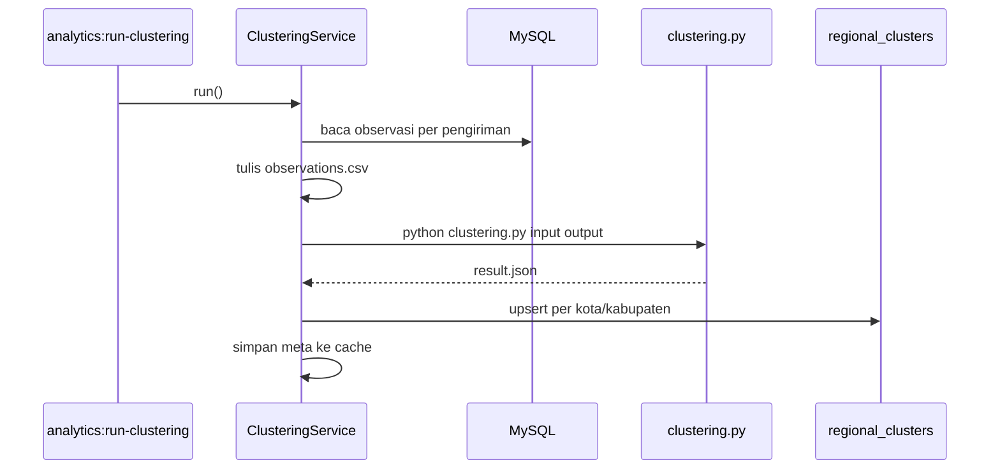

# Alur Data dan Sinkronisasi

## Sumber Data

Sumber utama adalah CSV publik Google Sheets pada sheet **ANL Publikasi** vendor
**BOMA**. URL disimpan di environment:

```env
GOOGLE_SHEETS_CSV_URL="https://docs.google.com/spreadsheets/.../pub?output=csv"
```

Aplikasi tidak memakai API Google atau OAuth. Karena CSV dipublikasikan, service cukup
mengunduh URL tersebut dengan HTTP client Laravel.

## Entitas Data



Tidak ada foreign key langsung antara `users` dan `shipments`; user adalah aktor
aplikasi, sedangkan shipment adalah data operasional.

## Sinkronisasi dari CSV

### 1. Pemicu

- `php artisan shipments:sync`
- `Schedule::command('shipments:sync')->hourly()`
- Tombol **Sync Sekarang** (`POST /sync`, middleware `auth` + `admin`)

### 2. Unduh dan Fingerprint

`ShipmentSyncService::sync()`:

1. Membaca `config('services.google_sheets.csv_url')`.
2. Menghitung `sha256` URL sebagai fingerprint.
3. Jika fingerprint berbeda dari cache, mode `replace` dipaksa.
4. Mengunduh CSV dengan timeout 120 detik.
5. Menyimpan body ke file sementara.

Tujuan fingerprint: ketika operator mengganti sheet di `.env`, data sheet lama tidak
tercampur dengan sheet baru.

### 3. Pre-flight Guard

Sebelum database disentuh:

- `countImportableRows()` menghitung baris yang benar-benar berisi data shipment.
- `assertImportIsSafe()` menolak jika:
  - jumlah baris valid `0`, atau
  - jumlah baris baru kurang dari 50% jumlah baris lama.

`--force` dapat melewati guard untuk kasus yang memang disengaja.

### 4. Pemetaan Header

Sumber memiliki nama kolom yang tidak selalu sama. `columnMap` menerima beberapa alias,
misalnya:

- `No Resi`
- `Tanggal HO ke Vendor` / `Tanggal Manifest`
- `Kabupaten/Kota` / `Kota/Kab Tujuan`
- `Update Stagging` / `Status update`

Header dinormalisasi menjadi lowercase, lalu `pick()` memilih nilai pertama yang tidak
kosong.

### 5. Pembersihan Baris

Urutan filter:

```text
baris CSV
  -> buang baris kosong
  -> map ke struktur shipment
  -> buang baris template tanpa data shipment
  -> normalisasi no_resi
  -> simpan
```

Baris template Google Sheets sering berisi nomor urut dan `FALSE`; baris seperti ini
tidak dianggap pengiriman. Sebaliknya, baris yang resinya rusak tetapi memiliki nama
sekolah/tanggal/status tetap disimpan dengan `no_resi = NULL`.

### 6. Normalisasi Resi

`normalizeResi()` menerima:

- 13–18 digit angka,
- notasi ilmiah seperti `1,0094E+15`,
- format ribuan seperti `1.009.400.821.166.140,00`.

Nilai `#N/A`, teks kosong, atau angka di luar panjang tersebut menjadi `NULL`.

### 7. Normalisasi Tanggal dan SLA

- `toDate()` memakai `checkdate()` agar tanggal mustahil seperti `31/02/2026` ditolak.
- `toSlaDays()` membaca SLA sebagai jumlah hari (1–365).
- `toThresholdDays()` membaca `Aging`/`SLA Threshold` dengan rentang 1–3650.
- Jika kolom `SLA` berisi tanggal, tanggal itu menjadi `sla_due_date`.
- Jika berisi jumlah hari, deadline dihitung dari `tgl_ho_sartrans + jumlah hari`.
- Jika jangkar lebih baru dari `completed_date`, deadline dibiarkan `NULL` agar baris
  tidak otomatis dianggap Meet SLA.

### 8. Penulisan Database

- Mode `replace`: seluruh tabel `shipments` dikosongkan.
- Mode normal: baris dengan resi yang sama dihapus lalu di-insert ulang.
- `no_resi NULL` juga dihapus pada sync normal agar tidak menumpuk.
- Insert dilakukan per 500 baris dengan `Shipment::insert()`.
- Semua operasi berada dalam `DB::transaction()`.

### 9. Duplikat

Resi yang muncul lebih dari sekali tidak digabung. Semua baris tetap disimpan, lalu
`markDuplicateNoResi()` mengisi `is_duplicate_no_resi = true` pada semua baris dengan
resi tersebut. Ini keputusan pemilik data agar jumlah baris sumber tidak hilang.

### 10. Cache

Setelah sukses:

| Cache key | Isi |
|---|---|
| `shipments.last_synced_at` | Waktu sync terakhir |
| `shipments.source_stats` | Statistik baris, duplikat, malformed |
| `shipments.source_fingerprint` | Hash URL sumber |

## Alur Dashboard

```mermaid
flowchart LR
    REQ[GET /?range=0|30|90] --> DC[DashboardController]
    DC --> Q1[KPI total/completed/on process]
    DC --> Q2[SLA meet/out/unverified]
    DC --> Q3[Tren harian]
    DC --> Q4[Pipeline stagging]
    DC --> Q5[Bottleneck provinsi]
    DC --> Q6[Vendor dan lead time]
    DC --> Q7[Aging dan perlu perhatian]
    Q1 --> VIEW[dashboard.blade.php]
    Q2 --> VIEW
    Q3 --> VIEW
    Q4 --> VIEW
    Q5 --> VIEW
    Q6 --> VIEW
    Q7 --> VIEW
```

Filter `range` hanya menerima `0`, `30`, atau `90`. Nilai lain jatuh ke `0` (semua waktu).
Range dihitung dari `completed_date` terakhir yang tepercaya, bukan `today()`, agar data
tetap terlihat ketika sheet belum diperbarui.

## Alur Modal Staging



API mengirim `id` agar `x-for` memiliki key unik, termasuk untuk baris `no_resi = NULL`.
Jika respons 401, frontend diarahkan ke login; jika respons bukan array, modal menampilkan
pesan error.

## Alur Data Pengiriman

- `GET /pengiriman` memakai filter status, provinsi, stagging, SLA, dan pencarian.
- Pencarian mencakup `no_resi`, `nama_sekolah`, dan `nama_penerima`.
- `POST /pengiriman/export` memakai filter yang sama dan menghasilkan `.xlsx`.
- Export menyertakan kolom verdict sheet dan verdict SLA yang dihitung ulang.

## Alur Clustering



Clustering hanya memakai wilayah dengan `kota_kabupaten` terisi dan data yang cukup.
Minimal 9 wilayah dengan `avg_aging` dan `out_sla_rate` valid untuk K-Means `k=3`.

## Alur Autentikasi

1. `GET /login` menampilkan form.
2. `POST /login` memvalidasi kredensial dan rate limit 5 percobaan.
3. Jika user `is_active = false`, sesi langsung logout dan login ditolak.
4. User diarahkan ke dashboard.
5. Middleware `admin` menjaga route manajemen user dan sync manual.

## Ringkasan Titik Rawan

| Titik | Risiko | Mitigasi |
|---|---|---|
| Sheet berubah/terfilter | Data lama terhapus | Shrink guard 50% |
| Resi kosong | Key modal duplikat | API mengirim `id` |
| Resi kembar | Baris hilang jika unique | Simpan semua + flag duplikat |
| Tanggal mustahil | Agregasi rusak | `checkdate` + `withConsistentDates` |
| SLA dua format | Verdict salah | Normalisasi ke `sla_due_date` |
| Sel kosong | Nilai palsu | Simpan `NULL` |
| Python gagal | Data clustering basi | Exception + cache lama dipertahankan |
