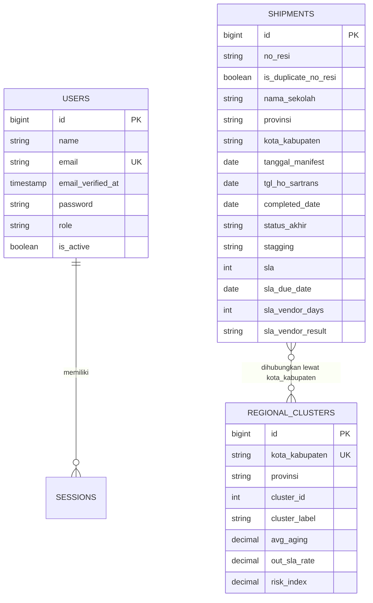

# Skema Database

## Gambaran Umum

Database utama bernama `anl_dashboard` (default di `.env.example`). Tabel yang dipakai
aplikasi:

| Tabel | Fungsi |
|---|---|
| `users` | Akun login dan otorisasi admin |
| `shipments` | Data pengiriman hasil sinkronisasi |
| `regional_clusters` | Hasil K-Means per kota/kabupaten |
| `sessions` | Sesi login berbasis database |
| `cache`, `cache_locks` | Cache statistik sync, metadata clustering, rate limit |
| `password_reset_tokens` | Token reset password |
| `jobs`, `job_batches`, `failed_jobs` | Infrastruktur queue Laravel |

## Relasi

Tidak ada foreign key fisik antara `shipments` dan `regional_clusters`. Hubungan bersifat
analitis: nama kota pada shipment dipakai sebagai kunci agregasi clustering.

## Tabel `shipments`

Dibuat pertama oleh `2026_09_02_020542_create_shipments_table.php`, lalu beberapa
migration menambah dan melonggarkan kolom.

### Identitas dan Relasi Operasional

| Kolom | Tipe | Catatan |
|---|---|---|
| `id` | bigint PK | Key unik untuk modal dan urutan fallback |
| `no_resi` | string nullable | Boleh NULL; tidak unik setelah migration duplikat |
| `is_duplicate_no_resi` | boolean | Penanda resi yang muncul lebih dari sekali |
| `nomor_redock` | string nullable | Nomor redock |
| `delivery_order` | string nullable | Delivery order / manifest first mile |

### Penerima dan Lokasi

| Kolom | Tipe | Catatan |
|---|---|---|
| `nama_sekolah` | string | Diindeks |
| `nama_penerima` | string nullable | |
| `provinsi` | string nullable | Diindeks, dipakai bottleneck |
| `daerah` | string nullable | |
| `kota_kabupaten` | string nullable | Kunci clustering |
| `kecamatan` | string nullable | |

### Vendor dan Funder

| Kolom | Tipe | Catatan |
|---|---|---|
| `vendor_mm` | string nullable | Vendor multimoda |
| `vendor_lm` | string nullable | Vendor last mile, diindeks |
| `kode_funder` | string nullable | |
| `nama_funder` | string nullable | |

### Tanggal

| Kolom | Tipe | Catatan |
|---|---|---|
| `tanggal_manifest` | date nullable | Tanggal HO ke vendor / manifest |
| `tgl_ho_sartrans` | date nullable | Titik first-mile dari SarTrans |
| `completed_date` | date nullable | Tanggal selesai |
| `tgl_sampai_kota_tujuan` | date nullable | Actual ETA / sampai kota |
| `bast_tgl_balik` | date nullable | BAST balik dari vendor |
| `bast_tgl_ke_finance` | date nullable | BAST dikirim ke finance |

### SLA dan Status

| Kolom | Tipe | Catatan |
|---|---|---|
| `sla` | int nullable | Ambang hari dari sumber |
| `sla_threshold_days` | int nullable | Dulu bernama `aging`; ambang, bukan umur |
| `sla_due_date` | date nullable | Deadline gabungan; diindeks |
| `sla_result` | string nullable | Verdict customer asli dari sheet |
| `sla_vendor_days` | int nullable | Ambang hari dari `SLA FOR VENDOR` |
| `sla_vendor_result` | string nullable | Label `RESULT FOR VENDOR`; diindeks untuk KPI/filter |
| `status_akhir` | string nullable | Status operasional |
| `status_instalasi` | string nullable | Diperlebar menjadi 255 karakter |
| `stagging` | string nullable | Tahap pipeline; diindeks |
| `status_invoice` | string nullable | `PAID` atau NULL |

### Nilai dan BAST

| Kolom | Tipe | Catatan |
|---|---|---|
| `koli` | int nullable | Jumlah koli |
| `harga_per_shipment` | decimal(15,2) nullable | NULL jika sumber kosong |
| `bast_keterangan` | string nullable | Keterangan BAST |

### Timestamp

`created_at` dan `updated_at` diisi saat insert. Karena import memakai `insert()` massal,
service mengisi timestamp secara manual di `flush()`.

## Tabel `users`

| Kolom | Tipe | Catatan |
|---|---|---|
| `id` | bigint PK | |
| `name` | string | |
| `email` | string unique | |
| `email_verified_at` | timestamp nullable | |
| `password` | string | Cast `hashed` |
| `role` | string(20) | Default `user`; admin dicek middleware |
| `is_active` | boolean | Default true; user nonaktif ditolak login |
| `remember_token` | string nullable | |
| `created_at`, `updated_at` | timestamp | |

Tabel terkait:

- `password_reset_tokens` untuk reset password.
- `sessions` untuk session driver database.

## Tabel `regional_clusters`

| Kolom | Tipe | Catatan |
|---|---|---|
| `id` | bigint PK | |
| `kota_kabupaten` | string unique | Kunci upsert |
| `provinsi` | string nullable | Provinsi dominan |
| `cluster_id` | tinyint | 0, 1, atau 2 |
| `cluster_label` | string | Label zona |
| `avg_aging` | decimal(8,2) nullable | Rata-rata durasi |
| `out_sla_rate` | decimal(5,2) nullable | Persentase Out SLA |
| `total_shipment` | int | Jumlah observasi |
| `verifiable_count` | int | Jumlah baris dengan data SLA lengkap |
| `risk_index` | decimal(5,2) nullable | Indeks risiko 0–100 |

`ClusteringService::persist()` melakukan upsert berdasarkan `kota_kabupaten`, lalu
menghapus wilayah yang tidak lagi muncul di hasil Python.

## Tabel Infrastruktur Laravel

| Tabel | Fungsi |
|---|---|
| `cache` | Menyimpan `shipments.last_synced_at`, statistik sumber, fingerprint, metadata clustering |
| `cache_locks` | Lock atomik cache |
| `sessions` | Sesi login |
| `password_reset_tokens` | Token reset password |
| `jobs` | Antrean pekerjaan (saat ini tidak dipakai untuk sync) |
| `job_batches` | Metadata batch job |
| `failed_jobs` | Job gagal |

## Indeks Penting

| Indeks | Alasan |
|---|---|
| `nama_sekolah` | Pencarian dan tampilan |
| `provinsi` | Filter dan bottleneck |
| `vendor_lm` | Statistik vendor |
| `tanggal_manifest` | Urutan dan tren |
| `completed_date` | Range dan SLA |
| `tgl_ho_sartrans` | Anchor deadline SLA |
| `sla_due_date` | Perhitungan SLA |
| `stagging` | Pipeline dan modal |
| `sla_result` | Diagnostik verdict sheet |
| `nama_funder + tanggal_manifest` | Analitik funder |
| `nama_funder + status_akhir` | Analitik status funder |

## Riwayat Migration Penting

1. **Create shipments** — skema awal dengan `no_resi` unik.
2. **Add stagging/SLA** — menambah pipeline dan verdict sumber.
3. **Role/is_active** — otorisasi admin dan penonaktifan akun.
4. **BAST** — tanggal dan keterangan BAST.
5. **tgl_ho_sartrans/koli** — memisahkan first-mile dan jumlah koli.
6. **sla_due_date + relax defaults** — menyatukan dua format SLA dan menghapus nilai karangan.
7. **Duplicate no_resi** — menghapus unique constraint dan menambah flag duplikat.
8. **Regional clusters** — tabel hasil K-Means.
9. **Widen status_instalasi** — menampung nilai sumber lebih dari 20 karakter.
10. **Vendor SLA** — menambah `sla_vendor_days` dan `sla_vendor_result` dari kolom sheet BOMA.

## Catatan Rollback

Migration duplikat dan relax-defaults memiliki rollback destruktif:

- Rollback duplikat menghapus baris `no_resi NULL` dan resi kembar.
- Rollback relax-defaults mengisi kembali nilai karangan (`0`, `BELUM`, `On Process`).

Keduanya hanya boleh dijalankan pada database development, bukan produksi.
